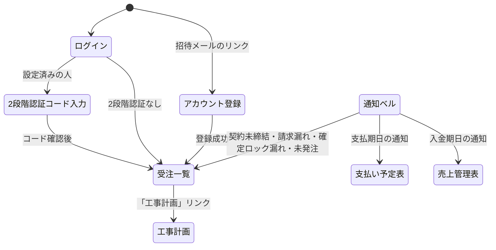

# 画面仕様書: construct-pro-next（現行の実装に合わせた版）

- **最終更新**: 2026-10-28（実装の現状に合わせて全面改訂。初版は 2026-08-31）
- **位置づけ**: 現在の実装の挙動を記述した仕様書。設計判断の理由は `docs/adr/` の各ADR、業務ルールの原本は `docs/poc-reference/business-rules.md` を参照する。実装と食い違いを見つけたら、先に実装（`src/`）を一次情報として確認し、本書を直す。
- **対象外**: 旧appとの対応関係の記述（旧appは切り替え時に停止する）。

---

## 1. ロールと画面の権限

権限表の唯一の定義元は `src/lib/roles.ts`（`PAGE_ROLES`）。サイドバー、画面のガード、API（tRPC）の許可は、すべてここから導出する。

| ロール | 表示名 | 書き込み | 見られる画面 |
| --- | --- | --- | --- |
| admin | 管理者 | 可 | すべて（アカウント発行・マスタの編集・確定ロックは管理者のみ） |
| accounting | 経理 | 可 | 受注一覧・工事計画・レポーティング・売上管理表・支払い予定表・マスタ（閲覧）・履歴 |
| staff | 一般社員 | 可 | 受注一覧・工事計画・レポーティング・マスタ（閲覧）・履歴 |
| viewer | 閲覧のみ | 不可 | 受注一覧・工事計画・レポーティング・マスタ（閲覧） |
| tax_advisor | 税理士・社労士 | 不可 | 受注一覧・工事計画・レポーティング・売上管理表・支払い予定表（マスタ・履歴・顧客の個人情報・口座の全桁は不可。通知も出さない） |

詳細は ADR-0015。

---

## 2. 画面一覧とサイドバー

サイドバーの構成（`src/components/shell/nav-config.ts`。表示はロールごとに絞られる）。

| メニュー | URL | 概要 |
| --- | --- | --- |
| レポーティング > 顧客別分析 | `/reporting/customers` | 顧客別・案件別の売上と粗利（粗利率）、5期推移 |
| レポーティング > 発注先別分析 | `/reporting/vendors` | 発注先別の発注金額・件数、上位シェア、偏り（HHI）、工種で絞り込み |
| 受注一覧 | `/projects` | 案件の一覧・進行管理・書類・請求書／見積書の発行 |
| マスタ設定 > 顧客マスタ | `/customers` | 顧客企業 |
| マスタ設定 > 発注先マスタ | `/vendors` | 発注先と振込先口座、支払条件 |
| マスタ設定 > 工種マスタ | `/categories` | 工種 |
| マスタ設定 > 銀行マスタ | `/banks` | 銀行と銀行コード、支店データの最新化・支店の手動管理 |
| マスタ設定 > 支払い種別マスタ | `/payment-categories` | 工事外の支払の区分（並び順がブロック順） |
| マスタ設定 > 収入区分マスタ | `/receipt-categories` | 工事外売上の区分 |
| マスタ設定 > 自社口座・手数料 | `/company-accounts` | 自社口座（デフォルト口座）と振込手数料ルール |
| 売上管理表 | `/receipts` | 案件別の入金、工事外売上 |
| 支払い予定表 | `/payment` | 発注先への支払、工事外の支払 |
| 履歴詳細 | `/history` | 操作履歴（監査ログ） |
| アカウント発行 | `/invite`（管理者のみ） | 招待の発行、アカウントの権限・停止/再開、2段階認証のリセット |

サイドバーに出ない画面:

| 画面 | URL | 概要 |
| --- | --- | --- |
| 工事計画 | `/orders-list?projectId=` | 案件ごとの発注明細（受注一覧の案件から遷移） |
| セキュリティ設定 | `/security` | 本人の2段階認証の設定（ヘッダーの盾のアイコン） |
| ログイン | `/login` | メール＋パスワード |
| 2段階認証コード入力 / 初回設定 | `/login/verify`、`/login/mfa-setup` | ログインの2段階目（認証アプリのコード、またはリカバリーコード） |
| アカウント登録（招待受諾） | `/accept-invite?token=` | 招待リンクからパスワードを設定 |
| パスワード再設定 | `/forgot-password`、`/reset-password` | 再設定メールの送信と設定 |

`/reporting` と、旧「工事計画」の案件選択ビューは廃止（それぞれ顧客別分析、受注一覧へ移動する）。

---

## 3. 共通仕様

### 3.1 ヘッダー

右上に、通知ベル（税理士・社労士を除く）、ログイン中のメールアドレスと権限、セキュリティ設定（盾）、ダークモード切替（月／太陽）、ログアウトの順で並ぶ。

### 3.2 通知

ADR-0018。ベルを開いたとき、その時点のデータから計算して表示する（送信はしない）。

- 種類: 支払期日超過、入金期日超過（売上管理表単位・請求書単位）、着工前アラート（契約未締結。工期終了後も契約書が締結されるまで）、未発注アラート（注文書・請書）、請求漏れアラート、支払期日の変更、月次確定ロック漏れアラート。**期日が近いだけの通知（接近）は出さない**
- 開封状態はユーザーごとに保存。毎朝10時（日本時間、Vercel Cron）に全員分を戻し、条件が続く通知を未開封として出し直す
- 表示: 「すべて」「未開封（件数）」の切替、カード形式、未開封はメニュー選択時と同じベージュの背景
- 「詳細を見る」: 対象の画面を、対象のID・年月で絞り込んだ状態で開き、行までスクロールする

### 3.3 排他制御

ADR-0017。対象は**支払い予定表・売上管理表・工事計画の3画面のみ**。

- 最初に開いた1名（1タブ）だけが編集できる。後から開いた人、同じ人の別タブは閲覧のみ（順番待ちなし）
- 閲覧のみの間は、画面上部に「現在 〇〇 さんが編集中です。閲覧のみ可能です（アップロード・更新はできません）。」を表示し、表・ダイアログの入力と更新ボタンを無効にする。サーバーも更新・アップロードを拒否する
- 解除: 編集者の最後の操作から15分、画面を閉じる・離れる、通信が15分途絶える。解除されると表示が消え、閲覧側が自動で編集できるようになる

### 3.4 ログイン・セッション・2段階認証

- ログイン後のセッションは7日。無操作1時間で自動ログアウトする（`reason=idle`）
- 2段階認証（ADR-0016）: 認証アプリ（6桁）またはリカバリーコード。スマホは1人2台まで。設定・追加はログインから15分以内。本人は無効にできず、管理者がリセットする。`MFA_ENCRYPTION_KEY` を設定すると有効になる。必須化するロールは `MFA_REQUIRED_ROLES`（現在は空＝全員任意）
- ログイン失敗の試行回数は制限する。停止中のアカウントはログインできない

### 3.5 アカウントの状態

アカウントは「有効」と「停止中」の2つ。削除はない（以前に削除されたアカウントは、停止中として表示し、再開できる）。管理者が「停止」「再開」を切り替える（自分自身は不可）。

### 3.6 その他の共通事項

- エラー表示: 予期しないエラーは「問題が発生しました」の画面（エラー番号付き）で、サーバーのログにも送る。存在しないURLは404の画面
- 検索エンジンに載せない（`noindex`、`X-Robots-Tag`）。セキュリティヘッダ（フレーム埋め込みの制限、`nosniff`、HSTS ほか）を付ける
- ページごとのタイトル（「画面名｜物件管理システム」）、ホーム画面追加用の manifest、紫のアイコン
- 表の「表示項目」で列の表示・非表示を切り替えられる画面がある（受注一覧・支払い予定表・売上管理表など）。選択はブラウザに記憶する
- 一覧は、20件ずつ追加表示（「次の件を表示」）
- **書類のアーカイブ（画面なし・月次バッチ）**: 引渡月から5年を過ぎた案件の書類（契約書・見積書・報告書などの書類・請書・請求書）は、毎月15日の23:00（日本時間）に、PDFの画像を再圧縮して案件ごとのZIPにまとめ、元の本体を空にする。その後は、画面から開けない（アップロード済みの印・ファイル名・通知の判定は変わらない）。ZIPは管理者だけが `/api/archives/{id}` から取得できる。発行した請求書は、再生成の経路があるため、画面から開ける（ADR-0021）

---

## 4. 画面詳細

### ログイン／2段階認証

- `/login`: メールアドレスとパスワード。パスワードを忘れた場合は `/forgot-password`。2段階認証を設定済みの人は、パスワードのあと `/login/verify` で6桁のコード（または「スマホが使えない場合」のリカバリーコード）を入力する。必須ロールで未設定の人は `/login/mfa-setup` で設定してからログインする
- 状態: 認証失敗、レートリミット超過、アカウント停止（「このアカウントは停止されています」）はフォーム内に表示

### アカウント発行（`/invite`、管理者のみ）

- 招待の発行（氏名・メール・権限）。招待メールは実際に送信される。発行済み招待の一覧（取消）
- 登録済みアカウントの一覧: 氏名/メール、権限（変更可）、ステータス（有効／停止中。「停止」「再開」）、登録日、メール署名（送信時に本文末尾へ付く）、2段階認証（有効の表示と「リセット」）
- 自分自身の行の権限・ステータスは変更できない。アカウントの削除はない

### セキュリティ設定（`/security`）

- 本人の2段階認証: 設定開始（QRコード）、スマホの追加・削除（最大2台、最後の1台は削除不可）、リカバリーコードの再発行

### 受注一覧（`/projects`）

- 期ごとのタブ（会計期。3月決算）。並びは案件ID昇順で固定。案件ID表記は「案件ID」（`WW{期2桁}-{連番}`、引渡月の期で採番）
- 表示項目（切替可）: 案件ID、工事名、備考、発注元、工期、引渡月、予定売上、契約金額、状態
- 金額（予定売上・契約金額）は工事計画の入力から自動反映（手入力不可）
- 状態（ステータス）: 未対応 → 提案中 → 見積確認中（表示は「見積書提出済み」）→ 受注（表示は「契約済み」）→ 請求書発行済み → 分割入金済み（売上管理表から設定）→ 全額入金済み。失注、オーダー移行（引渡月変更の複製元）
- 操作列: 工事計画へのリンク、請求書、報告書（工事完了報告書。任意）、契約書（締結済み/未締結）、見積書。書類の入れ替え、アップロード（PDFのみ・3MBまで）、プレビュー、メール送信（送信前の確認プレビュー）
- 引渡月の変更: 確認ダイアログのあと、新しい案件IDへ複製し、元の案件は「オーダー移行」（グレー・編集不可）。期をまたぐ場合は発注のみコピー（ADR-0008）
- 確定（ロック）: 管理者が、引渡月の末日を過ぎてから実行できる。確定した案件は金額・ステータスの編集が凍結される（ADR-0006）
- 警告の「!」アイコン、行のホバーでオレンジ枠、行クリックで編集
- 排他制御の対象外

### 工事計画（`/orders-list?projectId=`）

- 案件の発注明細（工種・発注先・見積額・予算額・決定額・ステータス・支払条件・支払期日・担当者）。ステータス: 未処理 → 見積待ち → 決定済み → 発注完了 → 支払済み
- サマリカード: 売上（予定・決定）、外注費合計（振込手数料込み）、想定利益額、想定粗利率（ADR-0019）
- 注文書PDF（2ページ）のプレビュー・メール送信、請書・請求書（受領）のドラッグ＆ドロップ添付（ファイル名は `日付_取引先_金額_書類名`、ADR-0010）、スマホ撮影の複数ページPDF化
- 排他制御の対象（scope: `plan:{案件ID}`）

### 売上管理表（`/receipts`）

- タブ: 工事売上／工事外売上。月（期・月の移動）で、入金期日または入金日がその月の案件を表示
- サマリカード3枚（当月入金予定額・実績額・未入金件数）。入金ステータスは「未入金」「分割入金済」「入金済」（入金済は契約金額が入金額。分割入金済は分割請求の一部が入金された状態で、最後の請求書以外は入金済みとみなす。入金額は全額入金済みのときだけ数える）。期日超過の未入金は行が薄い赤。分割請求の案件は、どの請求書の入金期日の月でも表示する
- 入金先口座は未選択がなく、未設定はデフォルト口座。請求書の振込先にも使う
- 工事外売上: 定期売上・単発の売上（売上ID `WS{期}-{月}-{連番}`）を、収入区分ごとのブロックで表示（ADR-0013）
- 排他制御の対象（scope: `receipts`）

### 支払い予定表（`/payment`）

- タブ: 工事支払／工事外。月（期・月の移動）で、支払期日がその月の行だけを表示（期日未設定は任意で表示）
- サマリカード3枚: 当月支払予定額・当月支払実績額（**どちらも振込手数料込み**）・当月予定件数
- 工事支払の列: 支払ID（`{案件ID}-{連番3桁}`）、案件ID、工事名、工種、発注先、支払予定額（決定額）、**振込手数料**（レコード生成時に固定。ADR-0019）、支払元口座（未選択なし。未設定はデフォルト口座）、支払条件、支払日、支払期日、支払いステータス（未払い／支払済み）、備考。期日超過の未払いは行が薄い赤、支払済みはグレー
- 工事外: 定期支払い（登録・当月支払いなし）と単発の支払。支払ID `WW{期}-{月}-{連番}`、支払い種別ごとのブロック。定期支払いの登録では、支払先を銀行マスタから選べ（銀行以外は入力）、銀行を選ぶとその銀行の支店を選べる（ADR-0020）
- CSV: 支払CSV（振込手数料の列つき）、全銀CSV（管理者・経理）
- 排他制御の対象（scope: `payments`）

### レポーティング

- 顧客別分析: 顧客別・案件別の売上と粗利、粗利率の棒グラフと表、顧客の5期推移。**粗利 ＝ 売上（契約金額）− 発注の（決定金額 ＋ 振込手数料）の合計**。オーダー移行・失注は除く
- 発注先別分析: 発注の件数・金額（決定金額ベース）、上位3社・5社のシェア、偏り（HHI）、パレート図、工種で絞り込み

### マスタ

- 顧客マスタ・発注先マスタ・工種マスタ: 一覧＋モーダル。発注先は、振込先口座（銀行・支店・預金種別・口座番号・名義）と支払条件（締め・支払日・支払月）を持つ。口座番号は管理者・経理だけ全桁を見られる
- 銀行マスタ（管理者が編集）: 銀行名・区分・銀行コード。「支店データを最新化」（任意のタイミング）、「支店の管理」（銀行ごとの手動の支店追加）。ADR-0020
- 支払い種別マスタ・収入区分マスタ: ドラッグで並び替え（並びが画面のブロック順）。工種マスタは、現在の工種のまま
- 自社口座・手数料: 自社口座（最大10件、デフォルト口座を1つ）と、口座ごとの振込手数料ルール（宛先区分: 同一銀行宛／他行宛、金額帯、手数料）。ルールを変えても、固定済みの手数料は変わらない

### 履歴詳細（`/history`）

- 操作履歴（DBの `audit_logs`）の一覧（日時・操作・種別・対象・変更内容・操作者）。新しい順に100件ずつ表示し、「追加読み込み」で全件まで辿れる。自動削除はしない（保管期間の定めなし）。口座番号などの値は残さず「変更した」とだけ記録する。対象画面と操作で絞り込む。見られるのは管理者・経理・一般社員（見える種別はロールごとに異なる。入金の履歴を一般社員に見せるかは未決）
- アカウントのステータスは「有効」「停止」と日本語で表示する

---

## 5. 画面の遷移

サイドバーからは、権限のある画面へ相互に遷移できる。
